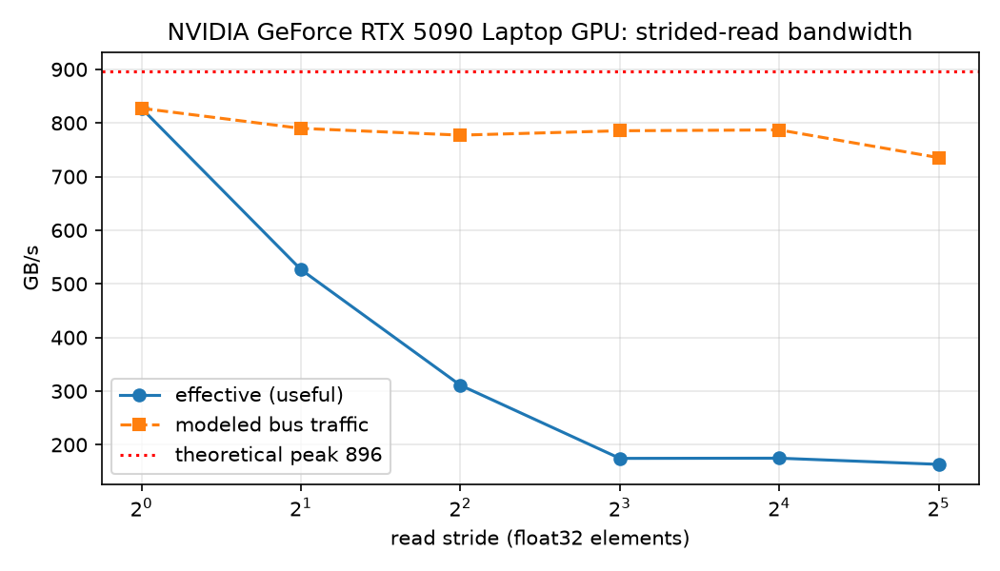

# Module 1: Strided vs. Contiguous VRAM Reads (RTX 5090 Laptop, 24 GB)

## Hypothesis (written BEFORE measuring)
- Peak: 896 GB/s theoretical (256-bit x 28 Gbps / 8). nvidia-smi reports a 14001 MHz
  memory clock; 28 Gbps is assumed from the GDDR7 spec, not independently verified.
- Contiguous copy reaches ~720-800 GB/s effective (80-90% of peak).
- Strided reads waste 7/8 of each 32B sector at stride >= 8. If DRAM-bound,
  slowdown is ~1.5x at stride 2, ~2.5x at stride 4, plateau ~4.5x from stride 8.
- Possible divergence at stride 32: LSU/L1-bound or latency-bound before DRAM-bound.

## Method
- N = 64Mi fp32 outputs, cold L2 (512 MiB flush), CUDA-event timing, median of 50.
- Env: torch 2.11.0+cu128, triton 3.6.0, Windows driver 616.56 (WSL user-mode 615.65.06),
  WSL2 Ubuntu 24.04.5, 82 SMs, sm_120.

## Results (3 runs, median per stride)

| Stride | Eff GB/s | Slowdown | Bus GB/s (modeled) | Predicted slowdown |
|--------|----------|----------|--------------------|--------------------|
| 1      | 827.4    | 1.00x    | 827.4              | n/a                |
| 2      | 528.0    | 1.55x    | 791.9              | ~1.5x              |
| 4      | 310.9    | 2.65x    | 777.3              | ~2.5x              |
| 8      | 175.3    | 4.68x    | 788.7              | ~4.5x              |
| 16     | 174.9    | 4.73x    | 787.1              | ~4.5x              |
| 32     | 163.4    | 5.03x    | 735.4              | ~4.5x              |

Raw data: benchmarks/results/run{1,2,3}.json and .png.

## Prediction vs measured
- Contiguous: predicted 80-90% of peak, measured ~92% (820.7 / 827.4 / 827.4 GB/s).
  The prediction was too conservative.
- Slowdown tracks the 32B-sector model through stride 8. Strides 8/16 sit a few
  percent above the 4.5x model in runs 1 and 3; run 2 was faster at strides 4-16.
- Stride 32: ~5.0x vs 4.5x modeled. Modeled bus throughput drops ~7-10% (734 / 757 /
  735 GB/s across runs). Reproducible; cause not yet identified (ncu is next).

## Caveats
- Peak 896 GB/s assumes 28 Gbps GDDR7 on 256-bit; nvidia-smi reports only a 14001 MHz clock.
- Bus GB/s is a model, not a measurement. ncu dram__bytes_read.sum will test it.
- SW power cap accrued ~40 ms (run 2) and ~260 ms (run 3); no thermal or power-brake events.
  Run 1's accrual is unknown. Mid-stride numbers vary ~5-7% between runs.

## Evidence

Effective bandwidth collapses ~5x while modeled bus traffic stays near 735-830 GB/s:
the slowdown is read amplification (32 B sectors fetched to use 4 B), not slower DRAM.

## ncu evidence (stride 32, 64Mi elements)
- Four elementwise_kernel launches of 16Mi elements each (65536 blocks x 128 threads x 2).
- Per launch: dram__bytes_read 536.9 MB (= 16Mi x 32 B), 32.0 sectors/request,
  L2 hit rate 0.02%, 674-677 us, DRAM throughput 95.4%, SM throughput ~3%.
- Sector model confirmed: 8x read amplification, measured. DRAM-bound inside the kernel;
  the LSU/L1-bound hypothesis is refuted.
- Misses: dram write 37-41 MB vs 67.1 MB modeled (likely dirty lines left in L2 at kernel end).
- 4 x 674 us = 2.70 ms vs 3.2-3.3 ms event time: ~0.5 ms outside kernel windows.

## Hypothesis 2 (written before testing)
PyTorch splits the stride-32 copy into 4 launches (source span > 2^31 bytes), and
inter-launch gaps cause the ~10% dip in modeled bus GB/s.
Prediction at --n-elems 16777216 (single launch at every stride): stride-32 median event
time ~0.68-0.72 ms (ncu kernel time 0.675 ms + small overhead), and modeled bus GB/s at
stride 32 within ~5% of strides 4-16. If it is clearly longer, the gap is not just splitting.
